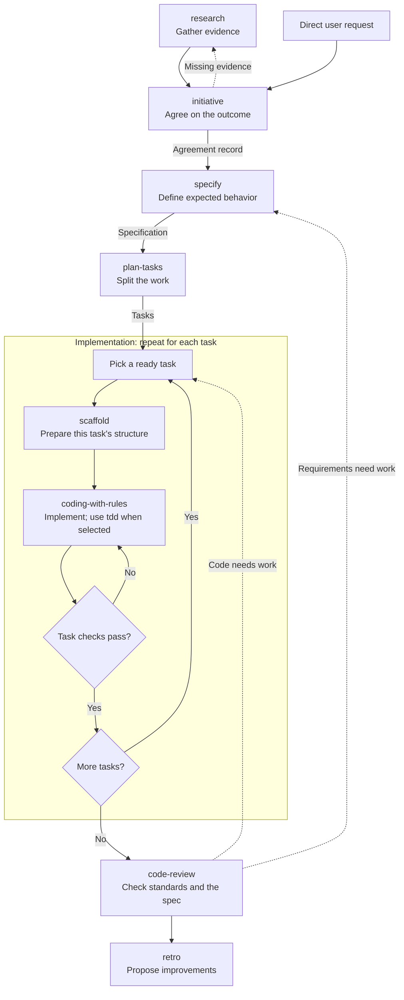
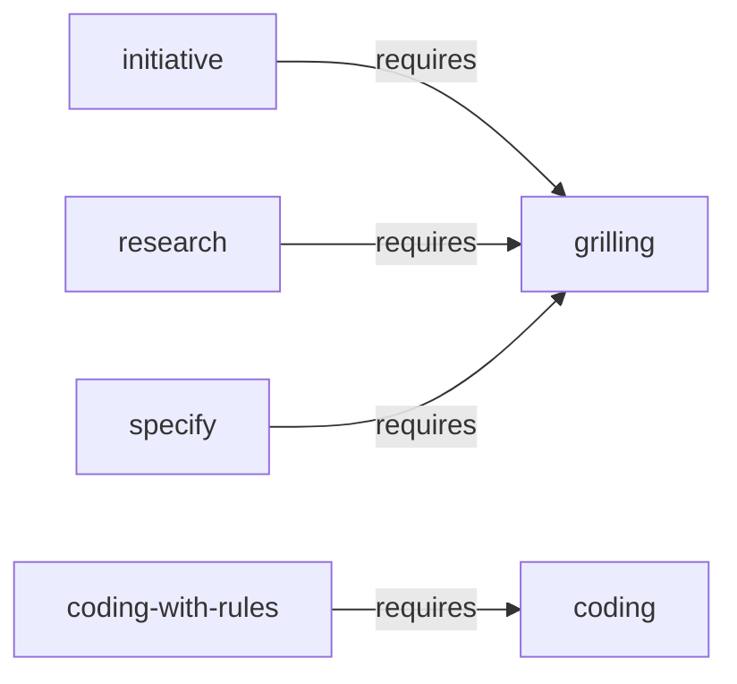

# AI agent assets

This repository contains reusable skills, instructions, configuration assets, and references for AI agents in coding and non-coding projects. The assets target Pi, OpenCode, and Claude Code, while portable skills follow the Agent Skills format.

## Documentation website

The VitePress site groups the catalogued skills by task and explains supported combinations with editable Archify diagrams. Start with the [documentation source](docs/index.md) or the [first-use guide](docs/guide/start.md).

After reviewing the project configuration and completing the [project-scoped mise setup](docs/maintenance/index.md):

```sh
mise run deps:sync
mise run docs:serve
```

Use `mise run docs` for a production build and `mise run docs:check` for catalog coverage, requirements, recipe, diagram, and local-link checks. Independent runs use `/`; hosted builds use `DOCS_BASE=/projects/ai-skills/`. See [site maintenance](docs/maintenance/index.md), [diagram regeneration](docs/maintenance/diagrams.md), and [publication](docs/maintenance/publication.md). The manual publisher exports an artifact by default and can open a destination PR; it does not merge or deploy.

## Skills

| Skill | Purpose |
|---|---|
| [`cleanup-workspaces`](.agents/skills/utility/cleanup-workspaces/SKILL.md) | Plan and safely remove integrated Git/Jujutsu workspaces and stale registrations. |
| [`asd-ste100-technical`](.agents/skills/documentation/asd-ste100-technical/SKILL.md) | Apply ASD-STE100-inspired plain language to developer-facing prose without losing technical precision. |
| [`code-review`](.agents/skills/coding/code-review/SKILL.md) | Review a diff against repository standards and its originating issue or specification with separate read-only subagents. |
| [`coding`](.agents/skills/coding/coding/SKILL.md) | Apply project-first design, security, testing, and quality gates to code changes in any language. |
| [`debloat`](.agents/skills/coding/debloat/SKILL.md) | Prevent overengineering and simplify existing mechanisms with evidence while preserving required behavior and boundaries. |
| [`document-project`](.agents/skills/documentation/document-project/SKILL.md) | Create or improve task-based documentation that a developer new to the project can follow, and keep it current during implementation. |
| [`excalidraw`](.agents/skills/documentation/excalidraw/SKILL.md) | Generate PNG/SVG diagrams locally with the official CLI and retain scene JSON for revisions. See the [first-use guide](.agents/skills/documentation/excalidraw/README.md). |
| [`coding-with-rules`](.agents/skills/coding/coding-with-rules/SKILL.md) | Combine the `coding` workflow with on-demand language and extension reference files. |
| [`init-project`](.agents/skills/coding/init-project/SKILL.md) | Initialize the shared foundation or TypeScript/Godot GDScript tooling through on-demand setup references. |
| [`grill-me`](.agents/skills/productivity/grill-me/SKILL.md) | Start an explicit grilling interview. |
| [`isolated-workspace`](.agents/skills/utility/isolated-workspace/SKILL.md) | Create or reuse a protected change workspace before repository mutation. |
| [`instruction-maintenance`](.agents/skills/unpolished/instruction-maintenance/SKILL.md) | Diagnose instruction drift, propose an exact adaptation, and wait for human approval before mutation. |
| [`initiative`](.agents/skills/productivity/initiative/SKILL.md) | Turn an idea and evidence into an outcome-level brief, using the required grilling interview. |
| [`plan-tasks`](.agents/skills/productivity/plan-tasks/SKILL.md) | Divide agreed scope into bounded tasks with completion evidence and genuine dependencies. |
| [`research`](.agents/skills/productivity/research/SKILL.md) | Research a question or idea using relevant sources, with or without an existing project. |
| [`retro`](.agents/skills/productivity/retro/SKILL.md) | Propose small process improvements from evidence about a work period. |
| [`specify`](.agents/skills/productivity/specify/SKILL.md) | Record agreed behavior, acceptance criteria, constraints, and test boundaries. |
| [`scaffold`](.agents/skills/coding/scaffold/SKILL.md) | Create reviewable source skeleton files with fail-fast placeholders and stop before implementing behavior. |
| [`subagent-orchestration`](.agents/skills/unpolished/subagent-orchestration/SKILL.md) | Bound child-agent workers and reviewers, coordinate isolated write lanes, and clean integrated temporary lanes. |
| [`systematic-debugging`](.agents/skills/coding/systematic-debugging/SKILL.md) | Diagnose failures through evidence, root-cause tracing, controlled experiments, and project-owned verification. |
| [`sync-my-skills`](.agents/skills/agentic-work/sync-my-skills/SKILL.md) | Investigate a project, choose skills and an optional instruction bundle, grill unresolved decisions, and apply one approved plan. |
| [`tdd`](.agents/skills/coding/tdd/SKILL.md) | Build features and fix bugs test-first through agreed public interfaces, one red → green slice at a time. |
| [`writing-for-agents`](.agents/skills/agentic-work/writing-for-agents/SKILL.md) | Write and refine instructions for agents, skills, prompts, and other agent-facing documents. |

The [YAML catalog](.agents/skills/agentic-work/sync-my-skills/assets/skill-catalog.yaml) is the single inventory for authored, upstream, and adapted skills. Upstream-only `archify`, `grilling`, `wait-what`, and `unslop` are listed there without vendored copies. It records sources, pinned revisions, installation commands, exclusions, legal files, prerequisites, and semantic adaptation intent.

## Independent skills and compositions

Skills load other instructions only through declared requirements. Leaves normally omit them; `cleanup-workspaces` explicitly requires `isolated-workspace` as an owner-approved exception. Select combinations explicitly, or use a thin composition such as `grill-me`, which declares `requires: ["grilling"]`. For code work, `coding-with-rules` declares `requires: ["coding"]` and selects its own language and extension reference files on demand. The former language and extension skills are replaced by those plain documents; see the [migration guide](.agents/skills/coding/coding-with-rules/README.md#migrate-existing-installations). Project instructions resolve requirements before applying the composition; its body defines the workflow. A requirement may resolve to an installed upstream skill identified by the YAML catalog. Stop and request approved setup when it is unavailable; do not download it implicitly.

`requires` is a project extension, not a native harness loader or standard Agent Skills field. External Skills CLI commands do not automatically install its requirements. See [the declaration and compatibility contract](CONTRIBUTING.md#independent-skills-and-explicit-composition). Shared helper-code dependencies remain distinct.

## Development flow

Start where you need help. If the goal is unclear, work through an initiative. If facts are missing, research them. If the work is already understood, go straight to a specification, task, or implementation. You do not need to run every skill.

During implementation, `document-project`, `asd-ste100-technical`, and `unslop` guide documentation updates in the same change. Improve unclear affected pages rather than append repetitive sections. Required documentation is part of completing the work; a new site, broad cleanup, migration, or deployment still needs its applicable approval.

`research` also works on its own for general questions and new ideas. It does not require a repository, an initiative, or an implementation decision. It clarifies the request when needed and delivers findings where the user chooses.

`initiative` accepts research findings, a direct request, or both. It reuses available context, investigates missing facts, and uses `grilling` to settle initiative-level decisions before writing. Research recommendations count as agreed decisions only after the user accepts them. Once the initiative is defined, it resolves where and how to save an agreement record, saves and verifies it, and reports the path or URL.

### Usual order and feedback



Solid arrows show the usual hand-offs, not automatic execution. Dotted arrows show where missing evidence or review findings send work back. Research can happen at any point, and a retro can help during a long effort as well as afterward.

Scaffold at the start of each task, after the tasks have been planned. Prepare the files, signatures, and contracts for that task, then implement and verify it before moving to the next. Preserve working code; do not replace it with placeholders.

The standalone `scaffold` skill still stops at its handoff. Continuing into implementation requires a separate explicit instruction; the arrows do not grant that permission.

Each skill answers a different question:

| Skill | Question | Output |
|---|---|---|
| `research` | What do we know, and what is still uncertain? | Findings with sources |
| `initiative` | Why do this, and what outcome matters? | Saved agreement record |
| `specify` | What must the solution do? | Saved specification with behavior, acceptance criteria, and test boundaries |
| `plan-tasks` | What work can we execute and verify? | Bounded tasks with dependencies and completion evidence |
| `scaffold` | What structure does this task need? | Source files, types, signatures, and explicit placeholders |
| `retro` | What should we improve next time? | Evidence-backed recommendations |

One initiative can lead to several specifications, each with several tasks. That does not require a separate file or issue for every level. Reuse what already exists, and implement and review one task at a time when that fits the work.

### Shorter paths

- **Small fix:** `systematic-debugging` if the cause is unknown → `scaffold` for the task → `coding-with-rules`, with `tdd` when selected → `code-review`.
- **Clear feature:** `specify` → `plan-tasks` if splitting the work helps → the scaffold, implementation, and verification loop above → `code-review`. No new initiative is needed if the outcome is already agreed.
- **Unclear direction:** move between `research` and `initiative` until the direction is settled, then write the specification. Return to research if new questions appear.

### Dependencies are not workflow order

These arrows mean **requires the target's instructions**, not **run this next**:



`initiative` uses the required interview to settle open decisions. `research` uses it only when the question, scope, or expected result is unclear. A clear research request skips the interview, although the required instructions still load. `specify` also uses `grilling` when detailed requirements or test boundaries need clarification, then records the confirmed answers. `coding-with-rules` adds language and extension guidance to the base coding workflow. Project routing loads each requirement before its caller, and managed synchronization includes it in the installation closure.

`plan-tasks` and `retro` have no declared skill dependencies. For example, `plan-tasks` can work from clear direct scope without first running `specify`. Select `tdd` and `code-review` separately; placing them in a workflow diagram does not make them declared requirements.

### Where the output goes

`initiative` and `specify` resolve delivery after clarifying their contents. They save at the agreed destination, verify the saved content, and return the actual path or URL. If saving is blocked, they provide prepared content marked "not saved".

For project work, document-generating skills consult `AGENTS.md` and `CONTRIBUTING.md` for destination and format. If those instructions leave this unclear, or there is no project context, ask the user where and how to deliver the output. Do not assume chat, a local file, or a tracker issue.

Agreeing on a document does not automatically authorize the next stage, delegation, or publication. Existing project gates still apply. Keep local, committed, pushed, and PR state separate: reviewed code is not necessarily published code.

## Use the skills

This repository groups source skills by purpose under `.agents/skills/<category>/<name>/`. Pi discovers those directories recursively. The categories are `productivity`, `coding`, `documentation`, `agentic-work`, `utility`, and `unpolished`; they do not create skill-name namespaces. Skill names remain globally unique.

`sync-my-skills` installs selected skills flat under a destination project's `.agents/skills/<name>/`, without category folders. Pi and OpenCode use those canonical installations. When Claude Code is selected, the manager creates relative `.claude/skills/<name>` projections there. This source repository has no Claude skill symlinks; its [`CLAUDE.md`](CLAUDE.md) still imports its own instruction graph. Synchronizing another project's skills does **not** copy that graph or change its root documents.

Install a local skill with an explicit command after reviewing it:

```sh
npx -y skills@1.7.4 add dragoscirjan/ai --skill isolated-workspace
```

Upstream-only skills are obtained from their catalogued sources, not from nonexistent directories in this repository. Raw Skills CLI installation alone does not guarantee prerequisite closure or OpenAI-metadata filtering.

For cross-project synchronization, follow [Sync skills in a project](.agents/skills/agentic-work/sync-my-skills/README.md). It starts with a clean export from a reviewed committed checkout, installs the personal manager and pinned parser, and registers the literal `/sync-my-skills` command. It also explains the repository-source alternative once this implementation is available upstream. The manager and all three harnesses are not forced into every project. Normal runs refresh compatible catalog data into a commit-pinned snapshot; offline/review use of the installed catalog is an explicit choice, not a silent fallback.

The LLM investigates the project's purpose and existing instructions, explains recommendations, asks about every remaining active catalog skill and exact deprecated removals, and offers instruction changes separately. For a selected bundle, it grills unresolved implementation/policy choices, drafts against the canonical templates, preserves existing rules, and obtains explicit policy and file-plan approval. It stages sources and semantic adaptations, presents one plan, and writes only after approval in an isolated Git worktree. Unrelated custom skills and local edits remain protected. Root instruction templates are reserved for [#68](https://github.com/dragoscirjan/ai/issues/68).

`sync-agent-assets` has been converted, not retained as a second compatibility skill. Existing lock data can migrate through an approved plan. The new command offers removal of old project installations; it never removes them automatically.

## Releases

After this workflow is merged, open **Actions → Version and release → Run workflow** on `main`. Choose `patch` (default), `minor`, or `major`. You can also trigger it with:

```sh
gh workflow run version.yml --ref main -f bump=patch
```

The workflow uses the highest stable `vX.Y.Z` Git tag as the current version. With no matching tags, the baseline is `0.0.0`, so the first patch release is **`v0.0.1`**. Minor and major bumps reset lower components. Unrelated tags, prereleases, and build-metadata tags are ignored. Versions belong to the repository as a whole, not individual skills; no version files or bump commits are needed.

A manual run tests the release tooling, creates a tag at the exact selected `main` commit, and immediately publishes a GitHub release with generated notes and `ai-vX.Y.Z.zip`. The ZIP contains Git-tracked files, including hidden skill directories and supporting files, under `ai-vX.Y.Z/`; it excludes untracked files and Git metadata. Relative Claude skill symlinks are preserved, so use an extractor that supports symlinks or a Git checkout when needed.

PRs and pushes affecting release tooling run its tests but never publish. Release jobs are serialized; concurrent pending runs may be superseded by GitHub, so do not queue multiple intended releases at once. If `main` advanced before the release checkout, the run stops; trigger a new run for the current commit. The workflow uses runner-provided Python 3.10+, Git, and GitHub CLI, plus the built-in `GITHUB_TOKEN` with `contents: write` only for the release job. No custom token, npm publishing, or Changesets setup is required. Repository or organization rules must permit tag creation and releases.

### Recover a retained tag

If publishing fails after tag creation, do not start a normal version run to repair it: that would select the next version. Recover the original tag instead. From a clone of this repository, fetch the retained tag without force and inspect its commit. Replace `v0.0.1` throughout these examples with the failed release's tag:

```sh
git fetch --no-tags origin refs/tags/v0.0.1:refs/tags/v0.0.1
git show --no-patch --format=fuller refs/tags/v0.0.1
```

Stop if the fetch fails, the commit is not the intended release, or the release is already published. If no release exists, rebuild its ZIP from that tag and create the missing release:

```sh
archive_dir="$(mktemp -d)" &&
git archive --format=zip --prefix=ai-v0.0.1/ \
  --output="${archive_dir}/ai-v0.0.1.zip" refs/tags/v0.0.1 &&
gh release create v0.0.1 "${archive_dir}/ai-v0.0.1.zip" \
  --repo dragoscirjan/ai --verify-tag --title v0.0.1 --generate-notes --latest=false
```

`--verify-tag` requires the retained remote tag; creating a release fails if a release already exists. No tag is moved or replaced. `--latest=false` avoids promoting an older recovered release over a newer release. If a partial draft already exists, inspect it, add any missing ZIP in GitHub's UI, and publish that same draft only after checking its tag and assets. Do not delete or overwrite an existing release or asset to recover.

### Preview the next version

The [version calculator](.github/scripts/release_version.py) is read-only and uses only tags already present in the local clone; it does not fetch tags or reserve a version. Compare local tags with this repository's remote tags before relying on its output, fetching with `git fetch --tags origin` when appropriate. Missing local tags or a later release can change the result. The workflow fetches all tags before calculating its version.

To check locally without creating a release:

```sh
python3 -B .github/scripts/release_version.py --bump patch
python3 -B -m unittest discover -s .github/scripts -p 'test_*.py' -v
```

## Repository map

- [`.agents/skills/`](.agents/skills/) contains portable Agent Skills.
- [`templates/`](templates/README.md) contains reusable project instruction templates and their population contract.
- [`AGENTS.md`](AGENTS.md) contains the small startup routing and safety contract for agents.
- [`CLAUDE.md`](CLAUDE.md) imports `AGENTS.md` for Claude Code.
- [`CONTRIBUTING.md`](CONTRIBUTING.md) contains contribution policy loaded before actionable change planning.
- [`VALIDATION.md`](VALIDATION.md) contains checks loaded before validation or publication.
- [`RESOURCES.md`](RESOURCES.md) contains the curated list of external tools and references.

## Contribute

Read [`CONTRIBUTING.md`](CONTRIBUTING.md) before planning a repository change. Run the applicable checks in [`VALIDATION.md`](VALIDATION.md) before publishing it.

Do not merge or release without explicit owner instruction.
